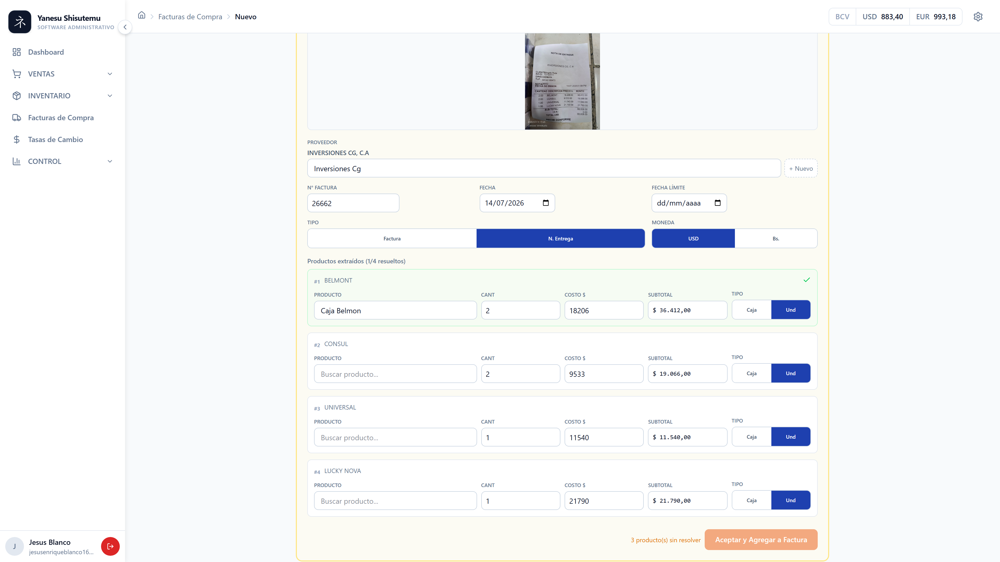
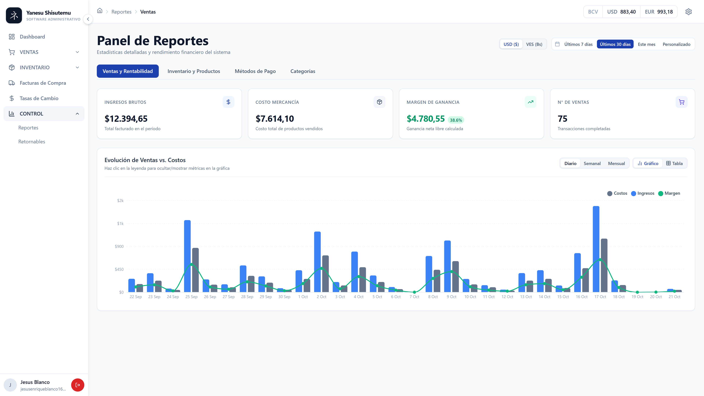
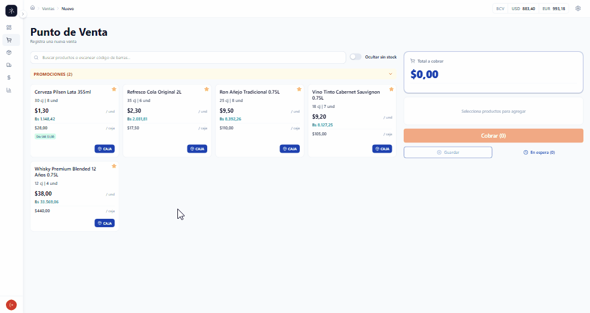
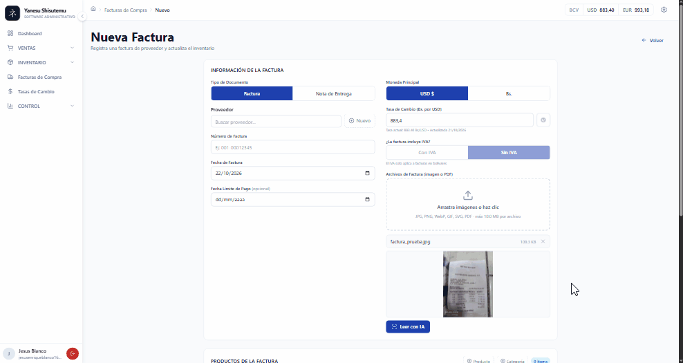
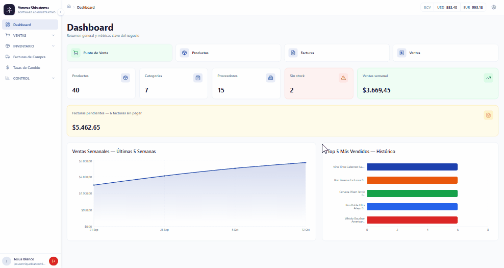
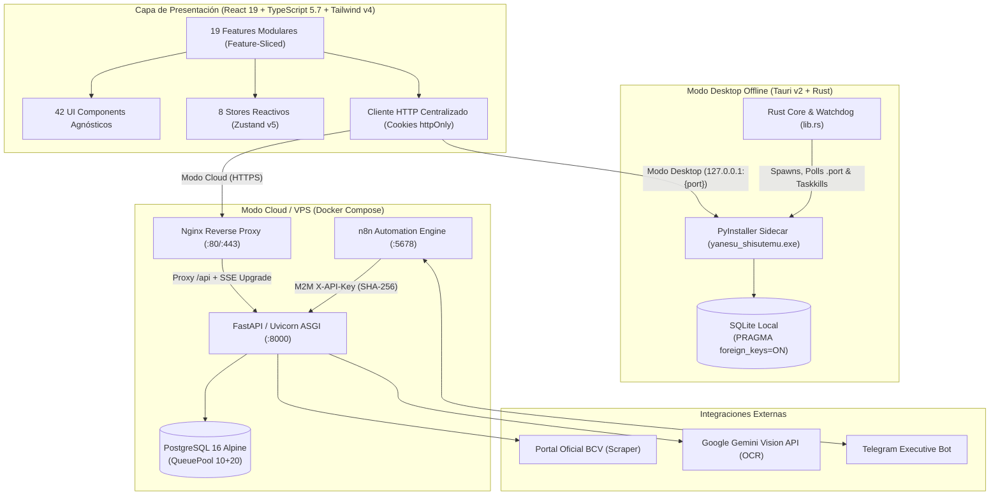
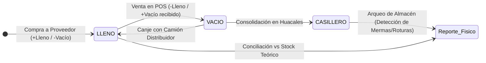

<div align="center">

# Yanesu Shisutemu (ヤネス・システム)

### Sistema ERP, Punto de Venta (POS) Bimonetario y Gestión de Inventario de Alto Rendimiento

[](https://fastapi.tiangolo.com/)
[](https://www.python.org/)
[](https://react.dev/)
[](https://www.typescriptlang.org/)
[](https://tailwindcss.com/)
[-FFC131?style=for-the-badge&logo=tauri&logoColor=black>)](https://v2.tauri.app/)
[](https://www.postgresql.org/)
[](https://www.docker.com/)

[-16A34A?style=flat-square&logo=pytest>)](./backend/tests/)
[-16A34A?style=flat-square&logo=vitest>)](./frontend/src/__tests__/)
[-EA580C?style=flat-square>)](./docs/PERFORMANCE_OPTIMIZATION_REPORT.md)
[-1E40AF?style=flat-square>)](./backend/tests/test_decimal_precision.py)
[](./LICENSE)

<p align="center">
  <b>Plataforma comercial en producción activa</b> diseñada para operar con precisión bancaria en economías bimonetarias (USD / VES), con arquitectura híbrida <b>Cloud VPS (Docker + PostgreSQL)</b> y <b>Desktop Offline (Tauri 2 + SQLite)</b>, extracción de facturas mediante <b>Google Gemini Vision OCR</b> y automatización M2M con <b>n8n + Telegram</b>.
</p>

[Explorar Caso de Estudio en Portafolio](https://portfolio-jesus-1205s-projects.vercel.app/projects/yanesu-shisutemu) · [Informe de Rendimiento](./docs/PERFORMANCE_OPTIMIZATION_REPORT.md) · [Especificaciones del Sistema](./docs/specs/) · [Guía de Despliegue VPS](./docs/DEPLOY_VPS.md)

</div>

---

## Tabla de Contenidos

1. [Contexto de Ingeniería y Problema Resuelto](#1-contexto-de-ingeniería-y-problema-resuelto)
2. [Demostraciones en Vivo (Flujos y Tiempos de Respuesta)](#2-demostraciones-en-vivo-flujos-y-tiempos-de-respuesta)
3. [Ingeniería de Rendimiento y Telemetría Auditada](#3-ingeniería-de-rendimiento-y-telemetría-auditada)
4. [Arquitectura del Sistema y Separación de Responsabilidades](#4-arquitectura-del-sistema-y-separación-de-responsabilidades)
5. [Pilares Técnicos y Decisiones de Diseño](#5-pilares-técnicos-y-decisiones-de-diseño)
6. [Estrategia de Calidad: 2.662 Pruebas Automatizadas](#6-estrategia-de-calidad-2662-pruebas-automatizadas)
7. [Stack Tecnológico](#7-stack-tecnológico)
8. [Instalación, Ejecución y Despliegue](#8-instalación-ejecución-y-despliegue)
9. [Índice de Documentación Técnica Profunda](#9-índice-de-documentación-técnica-profunda)
10. [Licencia y Servicios Profesionales](#10-licencia-y-servicios-profesionales)

---

## 1. Contexto de Ingeniería y Problema Resuelto

**Yanesu Shisutemu** es un sistema ERP y Punto de Venta (POS) actualmente **en producción comercial activa**, construido desde cero para resolver desafíos operativos y financieros donde el software genérico de inventario suele fallar:

- **Contabilidad Bimonetaria en Tiempo Real:** Presupuesta y protege el costo de reposición del inventario anclado en **Dólares Estadounidenses (USD)**, mientras liquida ventas, impuestos (IVA 16% / Exentos) y vueltos combinados en **Bolívares (VES)** sincronizados automáticamente con el Banco Central de Venezuela (BCV).
- **Logística Bimodal y Circuito Cerrado de Envases:** Administra existencias simultáneamente por **cajas cerradas** y **unidades detalladas** (con desempaque transaccional automático) y controla el ciclo físico de envases retornables (`LLENO`, `VACIO`, `CASILLERO`).
- **Continuidad Operativa Híbrida:** Funciona como servicio centralizado en la nube sobre contenedores Docker con **PostgreSQL 16** o como aplicación de escritorio nativa autónoma (**Tauri 2 + Rust + SQLite**) con menos de 50 MB de consumo de RAM y cero dependencia de internet.

---

## 2. Demostraciones en Vivo (Flujos y Tiempos de Respuesta)

> 💡 _¿Quieres ver el desglose visual interactivo y métricas adicionales? Visita la **[Sección Dedicada en mi Portafolio](https://portfolio-jesus-1205s-projects.vercel.app/projects/yanesu-shisutemu)**._

### A. Vistas Principales en Producción

|                            Punto de Venta Bimoneda (POS)                            |                                   Facturación y OCR con Gemini AI                                   |                                   Reportes y Analítica Financiera                                   |
| :---------------------------------------------------------------------------------: | :-------------------------------------------------------------------------------------------------: | :-------------------------------------------------------------------------------------------------: |
|  |  |  |
|     _Cobro en USD/VES a tasa oficial BCV, catálogo bimodal y desglose de IVA._      |            _Extracción multimodal estructurada (Human-in-the-Loop) con mapeo asistido._             |              _Evolución de ventas vs. costos, márgenes brutos y métricas de rotación._              |

---

### B. Flujos Operativos y Tiempos de Respuesta

#### 1. Facturación Rápida por Teclado y Cobro Mixto (POS)

Flujo transaccional operado 100% por teclado (`F2` búsqueda $\to$ selección Caja/Unidad $\to$ `F10` Checkout con split payment USD/VES y cálculo dinámico de vuelto).

<div align="center">
  
  <p><i>Escaneo de productos (<80ms), cálculo en vivo de vuelto cruzado USD/VES y confirmación transaccional.</i></p>
</div>

#### 2. Digitalización de Facturas con IA Multimodal (Google Gemini Vision)

Ingestión de factura física en dos fases desacopladas (metadatos + renglones) con validación supervisada _Human-in-the-Loop_.

<div align="center">
  
  <p><i>Preprocesamiento de imagen, extracción automática de ítems y vinculación asistida al catálogo local.</i></p>
</div>

#### 3. Rendimiento y Navegación Reactiva (Post-Optimización)

Transición instantánea entre módulos administrativos con latencias de API de entre **17 ms y 64 ms** sin recargas de página.

<div align="center">
  
  <p><i>Carga paralela con Skeleton screens y visualización fluida con Recharts.</i></p>
</div>

---

## 3. Ingeniería de Rendimiento y Telemetría Auditada

El sistema cuenta con una suite propia de benchmarking concurrente (`backend/scripts/benchmark_suite.py` sobre `httpx.ASGITransport`, evaluando 30 peticiones con concurrencia $c=5$). Durante el ciclo de optimización documentado en [`docs/PERFORMANCE_OPTIMIZATION_REPORT.md`](./docs/PERFORMANCE_OPTIMIZATION_REPORT.md), se lograron las siguientes mejoras en los dominios intervenidos:

### Resumen de Impacto Global (Dominios Optimizados)

| Métrica Consolidada                             |     Línea Base      |       Versión Optimizada       |                   Impacto Auditado                   |
| :---------------------------------------------- | :-----------------: | :----------------------------: | :--------------------------------------------------: |
| **Latencia Promedio Ponderada**                 |      184.18 ms      |          **63.04 ms**          |    **$-65.8\%$ de tiempo ($2.92\times$ speedup)**    |
| **Transferencia de Datos (Payload)**            |      112.89 KB      |          **26.80 KB**          | **$-76.3\%$ de ancho de banda ($-86.09\text{ KB}$)** |
| **Handshake TCP Inicial (PostgreSQL)**          |    ~2,047.45 ms     |      **~8.38 – 20.75 ms**      |    **$-98.9\%$ (elimina congelamientos de 2.1s)**    |
| **Retención de Conexión DB en SSE (`/stream`)** | ~150 s (bloqueante) | **$< 10\text{ ms}$ (efímera)** |     **Cero agotamiento del pool por streaming**      |
| **Round-trips HTTP al montar Dashboard**        |   8 concurrentes    |       **7 concurrentes**       |      **Elimina contención de sockets HTTP/1.1**      |

### Desglose de Endpoints Optimizados

| Dominio         | Endpoint / Operación              | Latencia Base | Latencia Optimizada |     Speedup     | $\Delta$ Latencia |   Payload Base $\to$ Opt   | $\Delta$ Payload  |
| :-------------- | :-------------------------------- | :-----------: | :-----------------: | :-------------: | :---------------: | :------------------------: | :---------------: |
| **Facturas**    | `/invoices?page=1&page_size=20`   |   352.6 ms    |     **58.0 ms**     | **$6.1\times$** |   **$-83.6\%$**   | 51.82 KB $\to$ **7.86 KB** |   **$-84.8\%$**   |
| **Ventas**      | `/sales/summary?rango=diario`     |   863.6 ms    |    **184.7 ms**     | **$4.7\times$** |   **$-78.6\%$**   |   5.34 KB $\to$ 5.34 KB    |      $0.0\%$      |
| **Facturas**    | `/invoices` (Próximas a vencer)   |   216.6 ms    |     **53.2 ms**     | **$4.1\times$** |   **$-75.4\%$**   | 24.49 KB $\to$ **3.35 KB** |   **$-86.3\%$**   |
| **Facturas**    | `/invoices/pending-summary`       |    75.8 ms    |     **43.7 ms**     | **$1.7\times$** |   **$-42.3\%$**   |   0.03 KB $\to$ 0.06 KB    | $+0.03\text{ KB}$ |
| **Reportes**    | `/reports/payment-methods`        |   221.0 ms    |    **133.5 ms**     | **$1.7\times$** |   **$-39.6\%$**   |   0.69 KB $\to$ 0.69 KB    |      $0.0\%$      |
| **Facturas**    | `/invoices/stats`                 |    49.6 ms    |     **30.2 ms**     | **$1.6\times$** |   **$-39.2\%$**   |   0.05 KB $\to$ 0.05 KB    |      $0.0\%$      |
| **Ventas**      | `/sales?page=1&page_size=20`      |    96.1 ms    |     **64.4 ms**     | **$1.5\times$** |   **$-33.0\%$**   | 21.34 KB $\to$ **8.59 KB** |   **$-59.7\%$**   |
| **Proveedores** | `/suppliers/summary` (Micro-KPI)  |    44.1 ms    |     **33.8 ms**     | **$1.3\times$** |   **$-23.4\%$**   | 1.73 KB $\to$ **0.08 KB**  |   **$-95.4\%$**   |
| **Inventario**  | `/products/top-selling?limit=5`   |    35.6 ms    |     **28.1 ms**     | **$1.3\times$** |   **$-21.0\%$**   | 2.62 KB $\to$ **0.59 KB**  |   **$-77.5\%$**   |
| **Categorías**  | `/categories/summary` (Micro-KPI) |    53.3 ms    |     **46.5 ms**     | **$1.1\times$** |   **$-12.8\%$**   | 4.70 KB $\to$ **0.11 KB**  |   **$-97.7\%$**   |

#### Optimizaciones Clave de Infraestructura Aplicadas:

1. **Pushdown de Agregaciones a SQL:** Sustitución de iteraciones en memoria Python por funciones nativas `func.sum(SaleItem.unidades_descontadas * Product.precio_costo_usd)` agrupadas en el motor relacional.
2. **Desacoplamiento de Sesiones en SSE (`/exchange-rates/stream`):** El endpoint de Server-Sent Events autenticaba mediante `Depends(get_db)`, reteniendo una conexión del `QueuePool` de SQLAlchemy durante toda la vida del stream. Se implementó `authenticate_stream_user` con `db.expunge(user)`, liberando la conexión en $<10\text{ ms}$.
3. **Eliminación de Timeout TCP SYN IPv6 (`::1` $\to$ `127.0.0.1`):** Corrección de resolución de loopback en entornos híbridos Windows/Docker que provocaba retrasos de 2.04 segundos en conexiones frías.

---

## 4. Arquitectura del Sistema y Separación de Responsabilidades

El proyecto implementa una arquitectura desacoplada que permite desplegar exactamente el mismo código base como plataforma web multi-usuario en la nube o como binario nativo de escritorio.



### Separación Estricta de Capas en Backend (`backend/app/`)

- **`routes/` (19 Routers REST):** Controladores delgados exclusivamente dedicados a validación de transporte HTTP, códigos de estado, aplicación de RBAC (`ADMINISTRADOR` / `OPERADOR`) y disparo de auditoría. **Prohibido ejecutar `db.commit()` o lógica de inventario en esta capa.**
- **`services/` (Orquestación de Dominio):** Reglas de negocio puras, transacciones ACID atómicas, desempaque de cajas, validación financiera `Decimal` y comunicación con servicios externos.
- **`schemas/` (Pydantic v2):** Contratos estrictos de entrada/salida con `ConfigDict(from_attributes=True, str_strip_whitespace=True)` y ocultamiento de hashes/secretos.
- **`models/` (SQLAlchemy 2.0):** **30 tablas relacionales** tipadas con `Mapped[T]`, `mapped_column()`, columnas calculadas persistidas (`Computed`) y políticas explícitas `ondelete="RESTRICT"` / `"CASCADE"`.

### Diseño Modular en Frontend (`frontend/src/`)

- **19 Módulos en `features/`:** Cada dominio (`sales`, `invoices`, `products`, `retornables`, `reports`, etc.) encapsula sus propios `components/`, `hooks/`, `pages/`, `store/` y `types.ts`.
- **Sistema de Diseño Propio (`ui-components/`):** 42 componentes presentacionales puros libres de acoplamiento con entidades de negocio.

---

## 5. Pilares Técnicos y Decisiones de Diseño

### 5.1. Política de Cero Flotantes (`Decimal` + `ROUND_HALF_UP`)

En sistemas financieros, la aritmética binaria IEEE 754 (`float`) introduce errores acumulativos ($0.1 + 0.2 = 0.30000000000000004$).

- **Backend como Única Fuente de Verdad:** Todo precio, costo, impuesto, subtotal y tasa se procesa exclusivamente mediante `decimal.Decimal` inicializado desde strings y cuantizado con redondeo bancario `ROUND_HALF_UP`.
- **Mitigación de Redondeo JS:** El backend recalcula de forma independiente cada venta enviada por el cliente React y aplica una ventana de tolerancia de exactamente $\$0.01\text{ USD}$ (`_TOLERANCIA_MONTOS = Decimal("0.01")`) para absorber diferencias de representación en navegadores sin comprometer la integridad contable.
- **Reparto de Combos sin Pérdida de Centavos:** Al vender un combo promocional a precio cerrado, `combo_service.py` distribuye el ingreso entre los productos miembros aplicando el _Largest Remainder Method_ (Hare-Niemeyer), garantizando que la suma de las partes cuadre al 100% con el total cobrado.

### 5.2. Logística Bimodal y Circuito Cerrado de Envases Retornables

El inventario maneja licores simultáneamente por **Caja** y por **Unidad**. Cuando una venta por unidad supera las botellas sueltas disponibles (`stock_unidades`), el motor transaccional abre automáticamente las cajas necesarias (`stock_cajas -= 1`, `stock_unidades += unidades_por_caja`).

Para productos retornables (presentaciones de 36 botellas / 222ml y 24 botellas / 333ml), el sistema engancha _hooks_ transaccionales automáticos en cada venta y compra:



### 5.3. Extracción OCR de Facturas en Dos Fases (Google Gemini AI)

Para digitalizar facturas físicas de proveedores sin sufrir alucinaciones ni mezclar totales con costos unitarios:

1. **Preprocesamiento con Pillow (`optimize_image`):** Aplanado de canal alfa a RGB blanco, redimensionamiento proporcional con filtro `Image.LANCZOS` (máx. 2000px) y compresión JPEG al 85% en memoria.
2. **Arquitectura Dual-Prompt Desacoplada:**
   - _Request 1 (`INVOICE_METADATA_PROMPT`):_ Extrae estrictamente cabecera, proveedor, RIF, fechas y moneda.
   - _Request 2 (`INVOICE_PRODUCTS_PROMPT`):_ Extrae la tabla secuencial de renglones, tipo de empaque (`CAJA`/`UNIDAD`) y costos unitarios en JSON estructurado con `temperature=0.0`.
3. **Supervisión Asistida (Human-in-the-Loop) vs. Fuzzy Matching Ciego:**
   - **Desafío en producción:** Inicialmente se evaluó vincular productos mediante coincidencia difusa (_fuzzy matching_). Sin embargo, en el comercio real cada distribuidor utiliza nomenclaturas, abreviaturas y códigos internos arbitrarios (imposibles de estandarizar algorítmicamente sin generar falsos positivos críticos en inventario).
   - **Solución implementada:** La IA extrae la descripción literal de la factura y la sitúa como referencia visual fija justo encima de un selector `Combobox` con autocompletado en tiempo real. Si el proveedor usa un alias críptico, el cajero busca el producto correcto en el catálogo local manteniendo a la vista la referencia textual exacta del papel físico.

### 5.4. Automatización M2M y Agente Ejecutivo en Telegram (`n8n`)

El backend expone una interfaz máquina-a-máquina bajo `/api/webhooks/*` y `/api/n8n/*` protegida por cabeceras `X-API-Key` (almacenadas en base de datos únicamente como hashes criptográficos **SHA-256**):

- **Sincronización Cambiaria Idempotente:** Flujo cron en n8n que extrae las tasas USD/EUR del BCV, las inyecta vía webhook y dispara una transmisión **Server-Sent Events (SSE)** que actualiza todos los terminales POS abiertos en $<200\text{ ms}$.
- **11 Herramientas de _Function Calling_ (`/api/n8n/tools/*`):** Permiten a la gerencia consultar en lenguaje natural por Telegram el stock crítico, horas pico de venta, métricas por rango de fecha, vencimiento de facturas y márgenes por categoría. Cada consulta queda registrada en la cola asíncrona de auditoría (`m2m:<api_key_name>`).

### 5.5. Ingeniería del Contenedor Desktop (Tauri 2 + PyInstaller Sidecar)

- **Handshake de Puerto Dinámico:** El backend Python sondea un socket libre entre los puertos `8000–8010` y lo escribe en `%LOCALAPPDATA%/YanesuShisutemu/.port`. El hilo nativo en Rust (`lib.rs`) mantiene una ventana _splashscreen_ hasta verificar `HTTP 200 OK` en `/api/health`.
- **Erradicación de Procesos Huérfanos:** Al cerrar la aplicación, Rust intercepta `RunEvent::ExitRequested` y ejecuta un cierre limpio del árbol de procesos en Windows (`taskkill /IM yanesu_shisutemu.exe /T /F` con flag `CREATE_NO_WINDOW = 0x0800_0000`).
- **Migraciones Dual-Dialect (`render_as_batch=True`):** Un único árbol de migraciones en Alembic mantiene paridad total entre SQLite local y PostgreSQL 16 en producción.

---

## 6. Estrategia de Calidad: 2.662 Pruebas Automatizadas

El repositorio mantiene una disciplina de pruebas exhaustiva que valida desde la precisión decimal y reglas de inventario hasta la renderización de cada componente React.

| Ecosistema                       | Framework                | Archivos de Test | Casos de Prueba | Estrategia de Aislamiento                                                                                      |
| :------------------------------- | :----------------------- | :--------------: | :-------------: | :------------------------------------------------------------------------------------------------------------- |
| **Backend (API & Servicios)**    | `pytest 8.3.4` + `httpx` |  **48 suites**   |  **972 tests**  | Base de datos SQLite efímera por test (`NamedTemporaryFile`) con `PRAGMA foreign_keys=ON` y teardown completo. |
| **Frontend (UI, Hooks, Stores)** | `vitest 2.1.8` + `RTL`   |  **249 suites**  | **1,690 tests** | Entorno `jsdom`, pruebas de máquinas de estado Zustand, simulación de escáner de barras y componentes UI.      |
| **TOTAL CONSOLIDADO**            | —                        |  **297 suites**  | **2,662 tests** | **100% de ejecución determinista offline.**                                                                    |

### Comandos para Ejecutar las Suites de Pruebas

```bash
# 1. Ejecutar los 972 tests del Backend (Integración + Servicios + Precisión Decimal)
cd backend
python -m pytest -v

# 2. Ejecutar los 1,690 tests del Frontend (React 19 + Zustand + UI Components)
cd ../frontend
pnpm test

# 3. Ejecutar la suite de Benchmark in-process (21 endpoints, 30 reqs, concurrencia 5)
cd ..
python backend/scripts/benchmark_suite.py --in-process --mode post -n 30 -c 5
```

---

## 7. Stack Tecnológico

| Capa                        | Tecnologías y Versiones                                                                                                                              |
| :-------------------------- | :--------------------------------------------------------------------------------------------------------------------------------------------------- |
| **Backend**                 | Python 3.12+, FastAPI 0.115.6, SQLAlchemy 2.0.51 (Declarative `Mapped`), Pydantic 2.13.4, Alembic 1.14.1, Uvicorn 0.34.0                             |
| **Seguridad & Cripto**      | JWT en Cookies `httpOnly` (`python-jose` HS256), `passlib[bcrypt]`, Cifrado Simétrico AES-128 Fernet (`cryptography` 44.0.3), API Keys SHA-256       |
| **Frontend**                | React 19.2.7, TypeScript 5.7.2, Vite 6.4.3, Tailwind CSS 4.3.3, Zustand 5.0.14, React Router 6.30.4, Recharts 3.10.1, SheetJS (`xlsx`), Lucide Icons |
| **Desktop Nativo**          | Tauri 2.11.5 (Rust Edition 2021), `reqwest`, `tauri-plugin-shell`, PyInstaller 6.11+, Instalador NSIS con hooks de limpieza                          |
| **Bases de Datos**          | PostgreSQL 16 Alpine (`psycopg[binary]` 3.2.9) en Cloud VPS / SQLite 3 con WAL y Foreign Keys activas en Desktop                                     |
| **DevOps & Automatización** | Docker Compose, Nginx Alpine (Reverse Proxy + SSE), GitHub Actions (CI/CD a GHCR), n8n Workflow Engine, Google Gemini Vision API, BeautifulSoup4     |

---

## 8. Instalación, Ejecución y Despliegue

### Opción A: Despliegue Completo con Docker Compose (Recomendado para VPS / Producción)

Levanta la base de datos PostgreSQL 16, el backend FastAPI (con migraciones y _seeds_ automáticos), el proxy Nginx con el frontend compilado y el motor de automatizaciones n8n:

```bash
# 1. Clonar el repositorio
git clone https://github.com/jesus-1205/yanesu-shisutemu.git
cd yanesu-shisutemu

# 2. Configurar variables de entorno
cp .env.example .env
# Editar .env con tus claves (SECRET_KEY, ENCRYPTION_KEY, POSTGRES_PASSWORD, GEMINI_API_KEY)

# 3. Iniciar los contenedores
docker compose up -d

# 4. (Opcional) Generar una API Key M2M para conectar flujos de n8n
docker compose exec backend python scripts/generate_api_key.py "n8n-production-agent"
```

### Opción B: Entorno de Desarrollo Local

#### 1. Backend (FastAPI + SQLite local)

```bash
cd backend
python -m venv venv
# En Windows: venv\Scripts\activate | En Linux/Mac: source venv/bin/activate
pip install -r requirements.txt

cp .env.example .env
alembic upgrade head
python run.py
# El servidor iniciará en http://127.0.0.1:8000
```

#### 2. Frontend (React 19 + Vite)

```bash
cd frontend
pnpm install
pnpm dev
# La aplicación estará disponible en http://localhost:5173 (con proxy hacia :8000)
```

#### 3. Compilación del Instalador Desktop (Tauri 2 + PyInstaller)

```powershell
# Desde Windows con Rust y Node.js instalados:
cd backend
.\build.bat
cd ..\licoreria-desktop
pnpm install
pnpm tauri build
```

---

## 9. Índice de Documentación Técnica Profunda

Para arquitectos de software y desarrolladores que deseen inspeccionar el diseño interno del sistema, el repositorio incluye especificaciones técnicas verificadas contra el código fuente:

- 📊 **[Informe de Optimización de Rendimiento y Benchmarks](./docs/PERFORMANCE_OPTIMIZATION_REPORT.md)**: Análisis detallado de cuellos de botella, SQL pushdown y telemetría de red.
- 🤖 **[Guía de Integración M2M con n8n y Telegram](./docs/N8N_INTEGRATION.md)**: Configuración de webhooks, scraping del BCV y agente conversacional.
- 🚀 **[Manual de Despliegue en VPS Ubuntu + SSL](./docs/DEPLOY_VPS.md)**: Configuración de producción con Docker, Nginx y Cloudflare Origin CA.
- 🗄️ **[Guía de Migración SQLite a PostgreSQL](./docs/MIGRATION_SQLITE.md)**: Procedimiento de transferencia de datos y sincronización de secuencias.
- 📚 **Especificaciones de Arquitectura (`/docs/specs/`)**:
  - [Capítulo 01: Stack Tecnológico, Dependencias y Runtimes](./docs/specs/01-tech-stack.md)
  - [Capítulo 02: Arquitectura del Sistema y Separación de Responsabilidades](./docs/specs/02-architecture-and-separation-of-concerns.md)
  - [Capítulo 03: Catálogo Exhaustivo e Inventario de 2.662 Tests](./docs/specs/03-test-suite-inventory.md)
  - [Capítulo 04: Especificación de Funcionalidades y Flujos de Usuario](./docs/specs/04-core-features-and-user-flows.md)
  - [Capítulo 05: Diferenciadores de Negocio frente a ERPs Genéricos](./docs/specs/05-business-differentiators.md)
  - [Capítulo 06: DevOps, CI/CD, Infraestructura y Automatizaciones](./docs/specs/06-devops-ci-cd-and-integrations.md)
  - [Capítulo 07: Modelo Relacional (30 Tablas) y Migraciones Dual-Dialecto](./docs/specs/07-database-models-and-migrations.md)

---

## 10. Licencia y Servicios Profesionales

Este proyecto se distribuye bajo la licencia **MIT** (consulta el archivo [`LICENSE`](./LICENSE) para más detalles). El código fuente es público con fines de auditoría técnica, portafolio de ingeniería y uso comunitario.

> **¿Interesado en implementar este sistema en tu negocio, desplegarlo en un VPS privado o contratar soporte y desarrollo a medida?**
>
> - 🌐 **Portafolio & Caso de Estudio:** [portfolio-jesus-1205s-projects.vercel.app/](https://portfolio-jesus-1205s-projects.vercel.app/)
> - 💼 **LinkedIn:** [linkedin.com/in/jesus-enrique-blanco](https://www.linkedin.com/in/jesus-enrique-blanco/)
> - 🐙 **GitHub:** [@jesus-1205](https://github.com/jesus-1205)
